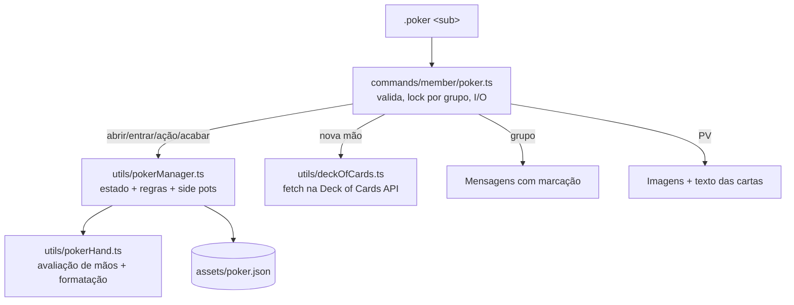

# Poker Design

**Spec**: `.specs/features/poker/spec.md`
**Status**: Approved (user mandou implementar: "certo, pode começar a codar!" - as abordagens alternativas não foram apresentadas)

---

## Architecture Overview

Motor puro e testável separado do I/O do WhatsApp. O comando lê o estado do arquivo, aplica a ação no motor, salva e traduz os eventos do motor em mensagens.



## Code Reuse Analysis

| Component | Location | How to Use |
| --- | --- | --- |
| Erros tipados | `src/errors` | `WarningError`/`InvalidParameterError`/`DangerError` para recusas |
| `formatPrice` | `src/utils/menuManager.ts` | Valores em centavos → `R$ 0,10` |
| Padrão de persistência | `src/utils/reminderManager.ts`, `menuManager.ts` | JSON em `assets/`, `mkdirSync` recursivo |
| Regra de admin | `src/middlewares/checkPermission.ts` | Mesma checagem de `groupMetadata` para iniciar/acabar |
| Marcações | `src/commands/member/markAll.ts` | `@<id antes do @>` no texto + JID em `mentions` |

## Components

### deckOfCards
- **Location**: `src/utils/deckOfCards.ts`
- **Interfaces**: `drawCards(count: number): Promise<string[]>` (códigos da API, ex. `0H`); `cardImageUrl(code): string`
- Uma chamada `GET /api/deck/new/draw/?count=N` com timeout de 10 s; lança `DangerError` em falha.

### pokerHand
- **Location**: `src/utils/pokerHand.ts`
- **Interfaces**: `formatCard(code)`, `formatCards(codes)`, `evaluateHand(cards: string[]): HandValue` (melhor de 5 entre 5-7), `compareHands(a, b)`.

### pokerManager
- **Location**: `src/utils/pokerManager.ts`
- **Interfaces**: `getTable/saveTable/deleteTable`, `withTableLock(chatId, fn)`, `parseAmount`, `createTable`, `addPlayer`, `startHand(table, cards)`, `applyAction(table, jid, action, amount?) → PokerEvent[]`, `getOptions(table)`, `finishTable(table) → summary`, `playersWithChips`.

### poker (comando)
- **Location**: `src/commands/member/poker.ts`
- Despacha os subcomandos, aplica o lock por grupo, manda cartas no PV e monta as mensagens a partir dos eventos.

## Data Models

```typescript
type PokerPlayer = {
    jid: string; name: string; buyIn: number; chips: number; // centavos
    cards: string[]; bet: number; committed: number;
    inHand: boolean; folded: boolean; allIn: boolean; acted: boolean; mayRaise: boolean;
};
type PokerTable = {
    chatId: string; minimum: number; smallBlind: number;
    players: PokerPlayer[]; started: boolean; dealer: number; handNumber: number;
    hand: null | { street: "preflop" | "flop" | "turn" | "river"; board: string[]; deck: string[];
                   current: number; currentBet: number; minRaise: number };
};
// assets/poker.json: Record<chatId, PokerTable>
```

## Error Handling Strategy

| Error Scenario | Handling | User Impact |
| --- | --- | --- |
| API do baralho falha/timeout | `DangerError`, mão não começa, blinds não lançados | Aviso no grupo; `.poker iniciar` tenta de novo |
| Imagem da carta falha no PV | ignora a imagem, manda o texto | Jogador recebe só o texto |
| Texto no PV falha | aviso no grupo marcando o jogador | Grupo sabe quem ficou sem cartas |
| Ação inválida / fora da vez | `WarningError` | Reply de aviso, mesa inalterada |
| `poker.json` corrompido | tratado como nenhuma mesa | Mesa perdida, bot segue |

## Risks & Concerns

| Concern | Location (file:line) | Impact | Mitigation |
| --- | --- | --- | --- |
| Prefixo `.` + busca aproximada de aliases | `src/utils/index.ts:135` | Mensagens casuais como `.a` acionam `markall`; `.ok` aciona `poker` | Levar ao user: exigir alias exato para o prefixo `.` (mudança de AD-001) |
| `sendText` espalha o array de marcações no objeto | `src/utils/loadCommonFunctions.ts:16` | Marcações com `sendText` podem não funcionar | Poker usa `socket.sendMessage` direto; bug relatado, não corrigido |
| Comandos concorrentes do mesmo grupo | handlers assíncronos | Duas ações intercaladas corrompem o estado | Lock por grupo (`withTableLock`) |

## Tech Decisions

| Decision | Choice | Rationale |
| --- | --- | --- |
| Compra de cartas | Todas as cartas da mão numa chamada | Menos rede; mão nunca para no meio por falha da API |
| Raise incompleto (all-in abaixo do mínimo) | `mayRaise=false` para quem já tinha agido | Regra oficial sem reabrir a rodada |
| Restante do pote em empate | Primeiro vencedor à esquerda do botão | Regra oficial |
